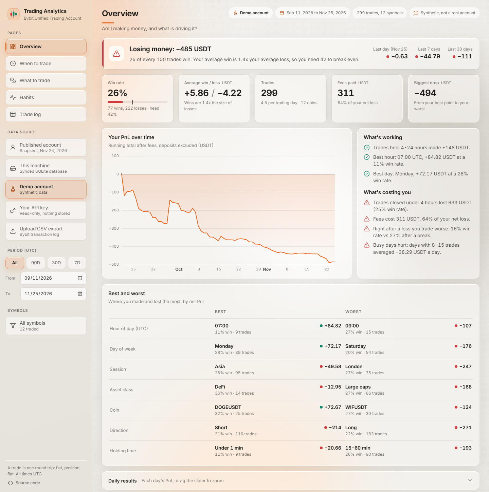

# Bybit Trading Analytics

An end-to-end data analysis project on my own crypto derivatives trading. It pulls
the full history of a Bybit **Unified Trading Account** through the **V5 REST API**,
rebuilds individual trades from raw fills, and answers one question: **does
this trading have an edge, and if not, where exactly does the money go?**

> Started as a one-off Colab notebook that explored a downloaded CSV ("how many
> rows, what types of records, what are the biggest changes"). This version
> replaces the manual export with an API pipeline, swaps descriptive questions for
> decision-oriented ones, and ships an interactive dashboard.

<!-- Screenshot: run the dashboard on demo data and save as docs/dashboard-overview.png

-->
> Try it without an API key: `python -m bybit_analytics demo`, then `streamlit run dashboard/app.py` and pick **Demo data**.

---

## The questions

| # | Question | Why it matters | How it's answered |
|---|----------|----------------|-------------------|
| 1 | **Am I profitable after all costs?** | Gross PnL hides fees and funding | Net PnL, return on deposits, equity vs. deposits |
| 2 | **Where does the PnL go?** | Shows whether losses come from bad trades or from costs | Waterfall: gross → fees → funding → net; effective fee rate on volume |
| 3 | **Is there an edge?** | Win rate means nothing without payoff | Win rate, payoff ratio, profit factor, expectancy, **break-even win rate** |
| 4 | **How bad does it get?** | Risk of ruin | Max drawdown (USDT), days under water, worst day, liquidations and what they cost |
| 5 | **Which symbols create or destroy value?** | Shows where to stop trading | PnL by symbol, Pareto of losses, trade count vs. PnL |
| 6 | **Longs or shorts?** | Directional bias | Side-by-side edge metrics |
| 7 | **When do I trade best/worst?** | Session effects | Hour × weekday heatmap of PnL (UTC) |
| 8 | **Do I cut winners and let losers run?** | Classic discretionary flaw | Holding-time buckets; median hold of winners vs. losers |
| 9 | **Do I revenge-trade?** | Tilt is measurable | Performance of trades opened ≤ N min after a loss vs. after a pause |
| 10 | **Do I overtrade?** | More trades ≠ more money | Trades per day vs. daily PnL (correlation + buckets) |
| 11 | **Does size or leverage hurt me?** | Sizing discipline | Notional quintiles; leverage buckets (from closed-PnL API) |
| 12 | **Is my PnL just the market?** | The "external factors" question the original notebook couldn't answer | Daily PnL vs. BTC daily return and volatility (public kline API) |

The dashboard writes the findings out as plain English, computed from the data
(e.g. *"Trades opened ≤15m after a loss average −0.90 USDT (18% win) vs −0.40
(25% win) after a pause"*).

## Architecture

```
Bybit V5 API ──► client.py ──► transform.py ──► storage.py (SQLite) ──► trades.py ──► analysis.py ──► dashboard/app.py
  (signed GET,     (7-day        (one canonical    (idempotent          (fills →        (metrics +       (Streamlit +
   pagination,      windows,      schema for API    upserts,             round-trip      questions)       Plotly)
   retries)         cursor)       and CSV)          incremental sync)    trades)
```

| Module | Responsibility |
|--------|----------------|
| `client.py` | Read-only V5 client: HMAC-SHA256 signing, clock-drift resync, rate-limit backoff, cursor pagination, automatic 7-day windowing (Bybit's max query span) over the 2-year history limit |
| `transform.py` | Normalizes the API's JSON **and** Bybit's CSV export into one schema. Fee and funding signs differ between the two, so they are derived from the identity `change = cash_flow + fee + funding` |
| `storage.py` | SQLite store with upserts, so re-running `sync` is safe and incremental |
| `trades.py` | Rebuilds **round-trip trades** (flat → position → flat) from fill-level data using the signed post-trade position size. Handles multi-fill orders, position flips, positions already open when the data starts, and assigns funding payments to the position open at the time |
| `analysis.py` | All metrics and the 12 questions as pure functions returning DataFrames. The dashboard, CLI and tests all call these |
| `charts.py` | Plotly figures using a colorblind-validated palette (blue = gain, red = loss) |
| `demo.py` | Synthetic account generator, so the project runs with no API key |

### Endpoints used

| Endpoint | Purpose | Auth |
|----------|---------|------|
| `GET /v5/account/transaction-log` | Every fill, funding settlement and transfer (same data as the CSV export) | read-only key |
| `GET /v5/position/closed-pnl` | Closed positions with leverage | read-only key |
| `GET /v5/account/wallet-balance` | Current equity snapshot | read-only key |
| `GET /v5/market/kline` | BTC daily candles for market context | public |

## Quick start

```bash
git clone https://github.com/fleming-c137/bybit-trading-analytics.git
cd bybit-trading-analytics
python -m venv .venv && .venv\Scripts\activate      # macOS/Linux: source .venv/bin/activate
pip install -e ".[dev]"
```

**Option A: your account via the API**

1. Create a **read-only** API key at Bybit → Account → API Management (no Trade/Withdraw/Transfer permissions; IP-restrict it if you can).
2. `cp .env.example .env` and fill in `BYBIT_API_KEY` / `BYBIT_API_SECRET`.
3. Sync and explore:

```bash
python -m bybit_analytics sync            # first run pulls up to 2 years; later runs are incremental
python -m bybit_analytics report          # key findings in the terminal
streamlit run dashboard/app.py
```

**Option B: a CSV export.** `python -m bybit_analytics import-csv path/to/AssetChangeDetails_uta_*.csv`, or upload it in the dashboard sidebar.

**Option C: demo data.** `python -m bybit_analytics demo`, then pick *Demo data* in the dashboard.

Run the tests with `pytest`.

## Methodology notes

- **Net PnL** = sum of wallet `change` excluding transfers. Round-trip PnL reconciles to it exactly (tested).
- **A trade** is one round trip. Fills in the same second on the same side are treated as one order.
- **Max drawdown** is measured in USDT on cumulative PnL. A percentage drawdown misleads on an account that is topped up repeatedly.
- **Time-weighted return** is chained event by event, so deposits don't distort it.
- **Partial trades** (already open when the data starts) count toward PnL but not toward holding-time or size statistics.
- Times are UTC. The analysis assumes a USDT-margined account.

## Security & privacy

- The client only implements GET requests. It cannot trade or move funds.
- `.env`, `data/` and `reports/` are git-ignored. Your keys and trading history never leave your machine.
- Public screenshots come from synthetic demo data.

## Roadmap

- [ ] Scheduled sync (cron / GitHub Action to a private store)
- [ ] Spot and options categories
- [ ] Benchmark against buy-and-hold BTC over the same capital path
- [ ] Monte Carlo of the trade distribution → probability of ruin
