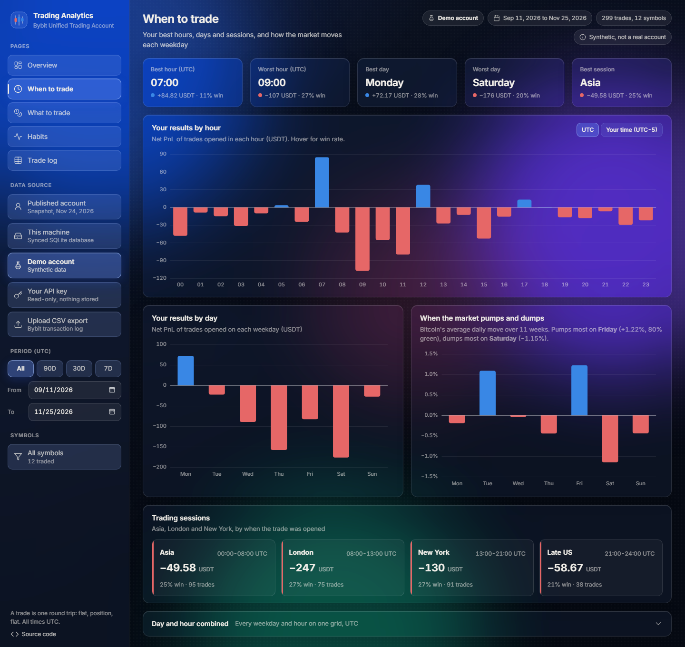
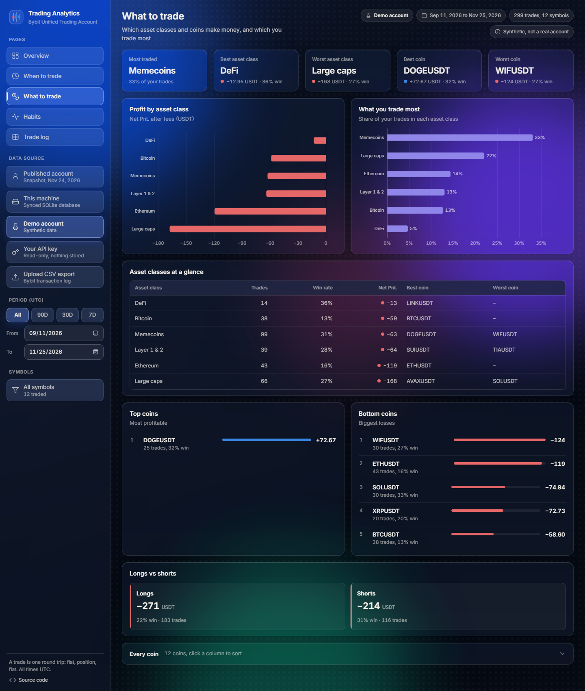
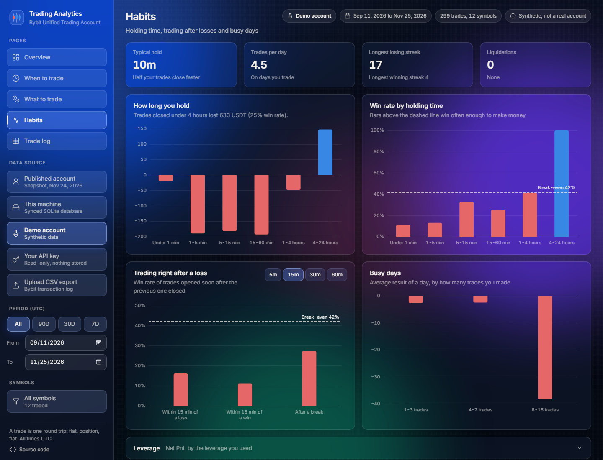

# Bybit Trading Analytics

An end-to-end data analysis project on my own crypto derivatives trading. It pulls
the full history of a Bybit **Unified Trading Account** through the **V5 REST API**,
rebuilds individual trades from raw fills, and answers one question: **does
this trading have an edge, and if not, where exactly does the money go?**


> Started as a one-off Colab notebook that explored a downloaded CSV ("how many
> rows, what types of records, what are the biggest changes"). This version
> replaces the manual export with an API pipeline, swaps descriptive questions for
> decision-oriented ones, and ships an interactive dashboard that anyone can run
> on their own account.

---

## What my account shows

Two years of real history: 54,581 transaction-log rows, rebuilt into **7,236
round-trip trades on 406 USDT perpetuals**.

| | |
|---|---|
| **Net result** | **−3,554 USDT** on 6,515 deposited (−54.6% of deposits) |
| **Win rate** | 21 of every 100 trades win. Wins are 2.1x the size of losses, so 32 would break even |
| **Fees** | **1,843 USDT**, about half of the total loss |
| **Holding time** | Trades closed within an hour lost **5,071**; trades held 1–24 hours made **+1,513** |
| **When** | Every weekday lost money; Sunday least (−273), Tuesday most (−661). The New York session was the worst (−1,659) |
| **What** | Most trades are small caps and new listings (35%). Memecoins lost the most (−1,094) |
| **Busy days** | The more trades in a day, the worse the day (correlation −0.47) |
| **Direction** | Longs −3,131 vs shorts −423 |
| **The market** | Over 104 weeks BTC rose most on Wednesdays (+0.35% average, 53% green) and fell most on Thursdays (−0.60%) |

**The takeaway:** the losses are not bad luck or one bad coin. They come
from a fast scalping style whose fee bill alone is as large as its trading loss.
The same account is profitable when positions are held for hours. The data's
recommendation is to trade less often and hold longer.

## The questions

| # | Question | Why it matters | How it's answered |
|---|----------|----------------|-------------------|
| 1 | **Am I profitable after all costs?** | Gross PnL hides fees and funding | Net PnL, return on deposits, equity vs. deposits |
| 2 | **Where does the PnL go?** | Shows whether losses come from bad trades or from costs | Waterfall: gross → fees → funding → net; effective fee rate on volume |
| 3 | **Is there an edge?** | Win rate means nothing without payoff | Win rate, payoff ratio, profit factor, expectancy, **break-even win rate** |
| 4 | **How bad does it get?** | Risk of ruin | Max drawdown (USDT), days under water, worst day, liquidations and what they cost |
| 5 | **Which symbols create or destroy value?** | Shows where to stop trading | PnL by symbol, share of losses, trade count vs. PnL |
| 6 | **Longs or shorts?** | Directional bias | Side-by-side edge metrics |
| 7 | **When do I trade best/worst?** | Session effects | Hour × weekday heatmap of PnL (UTC) |
| 8 | **Do I cut winners and let losers run?** | Classic discretionary flaw | Holding-time buckets against the break-even win rate; median hold of winners vs. losers |
| 9 | **Do I revenge-trade?** | Tilt is measurable | Trades opened ≤ N min after a loss vs. after a pause (5/15/30/60 min) |
| 10 | **Do I overtrade?** | More trades ≠ more money | Trades per day vs. daily PnL (correlation + buckets) |
| 11 | **Does size or leverage hurt me?** | Sizing discipline | Notional quintiles; leverage buckets (from closed-PnL API) |
| 12 | **Is my PnL just the market?** | The "external factors" question the original notebook couldn't answer | Daily PnL vs. BTC daily return and volatility (public kline API) |

## The dashboard

Built for a trader to read at a glance, not for a data scientist. Every page answers one question,
leads with the answer and keeps detail folded away.

| Page | Answers |
|---|---|
| **Overview** | Am I making money? A one-line verdict, the last day / 7 days / 30 days, win rate (wins and losses), average win vs loss, fees, biggest drop, PnL over time, *what's working* and *what's costing you*, and a best-vs-worst table by hour, day, session, asset class, coin, direction and holding time |
| **When to trade** | Best and worst hour and day, results by hour (UTC or your own time zone), by weekday and by session (Asia, London, New York), and **which weekdays the market tends to pump or dump** (BTC average daily move and share of green days) |
| **What to trade** | Profit by asset class (Bitcoin, Ethereum, large caps, layer 1 & 2, DeFi, AI, memecoins, gaming, small caps & new listings), what you trade most, top and bottom coins, longs vs shorts |
| **Habits** | How long you hold vs results, win rate right after a loss, busy days, leverage |
| **Trade log** | Every round trip, searchable and downloadable |



| What to trade | Habits |
|---|---|
|  |  |

Screenshots use the synthetic demo account.

**Data sources in the sidebar**

| Source | What it is |
|---|---|
| Published account | A snapshot of my account (`snapshots/owner.json.gz`), made locally with `publish` |
| This machine | Your synced SQLite database. Only appears when you run the dashboard locally |
| Demo account | Synthetic data, so the project works with no key at all |
| Your API key | A visitor's own read-only key, last 7–90 days, fetched live |
| Upload CSV export | Bybit's "Asset Change Details" export (up to 4 MB on the hosted site) |

## Architecture

```
Bybit V5 API ──► client.py ──► transform.py ──► storage.py (SQLite) ──► trades.py ──► analysis.py / trader.py ──► report.py ──► /api/report ──► public/ (HTML + ECharts)
```

| Module | Responsibility |
|--------|----------------|
| `client.py` | Read-only V5 client: HMAC-SHA256 signing, clock-drift resync, rate-limit backoff, cursor pagination, automatic 7-day windowing (Bybit's max query span) over the 2-year history limit |
| `transform.py` | Normalises the API's JSON **and** Bybit's CSV export into one schema. Fee and funding signs differ between the two, so they are derived from the identity `change = cash_flow + fee + funding` |
| `storage.py` | SQLite store with upserts, so re-running `sync` is safe and incremental |
| `trades.py` | Rebuilds **round-trip trades** (flat → position → flat) from fill-level data using the signed post-trade position size. Handles multi-fill orders, position flips, positions already open when the data starts, and assigns funding payments to the position open at the time |
| `analysis.py` | All metrics and the 12 questions as pure functions returning DataFrames |
| `trader.py` | Trader views: sessions, weekdays, market pump/dump days, best-vs-worst, plain-English highlights |
| `assets.py` | Maps tickers to asset classes (multiplier tickers like `1000PEPE` count as memecoins) |
| `report.py` | Turns a dataset plus filters into the JSON the dashboard renders; serialises datasets |
| `webapi.py` | The one API endpoint: data sources, visitor keys, CSV uploads, caching |
| `server.py` / `api/report.py` | The same endpoint served locally (`serve`) or as a Vercel Python function |
| `public/` | The dashboard: plain HTML, CSS and JavaScript with ECharts. It only lays out numbers; it computes none |
| `demo.py` | Synthetic account generator |

### Endpoints used

| Endpoint | Purpose | Auth |
|----------|---------|------|
| `GET /v5/account/transaction-log` | Every fill, funding settlement and transfer (same data as the CSV export) | read-only key |
| `GET /v5/position/closed-pnl` | Closed positions with leverage | read-only key |
| `GET /v5/account/wallet-balance` | Current equity snapshot | read-only key |
| `GET /v5/market/kline` | BTC daily candles for market context | public |

## Quick start

```bash
git clone https://github.com/fleming-c137/bybit-trading-analytics.git
cd bybit-trading-analytics
python -m venv .venv && .venv\Scripts\activate      # macOS/Linux: source .venv/bin/activate
pip install -e ".[dev]"
python -m bybit_analytics serve                     # opens http://localhost:8000 with the demo account
```

**Your own account through the API**

1. Create a **read-only** API key at Bybit → Account → API Management (no Trade/Withdraw/Transfer permissions; IP-restrict it if you can).
2. `cp .env.example .env` and fill in `BYBIT_API_KEY` / `BYBIT_API_SECRET`.
3. Sync, then explore:

```bash
python -m bybit_analytics sync            # first run pulls up to 2 years; later runs are incremental
python -m bybit_analytics report          # key findings in the terminal
python -m bybit_analytics serve           # "This machine" appears as a data source
```

**A CSV export instead:** `python -m bybit_analytics import-csv path/to/AssetChangeDetails_uta_*.csv`, or upload it in the dashboard.

Run the tests with `pytest`.

## Hosting

The repo deploys to **Vercel** as is: `public/` is served as a static site and
`api/report.py` runs as a Python serverless function (`vercel.json`).

1. Import the GitHub repo at vercel.com/new. Leave the framework preset on "Other" and the build settings empty.
2. Deploy. There are no environment variables to set.

**How my key stays private while my results are public.** The hosted site never
holds my API key. I sync on my own machine and run:

```bash
python -m bybit_analytics publish         # writes snapshots/owner.json.gz from the local database
git add snapshots/owner.json.gz && git commit -m "Update snapshot" && git push
```

Vercel redeploys and the "Published account" source updates. The snapshot holds
the trading history (fills, fees, transfers, balances), not credentials. Anyone can
download it, so publish only an account you're happy to show.

**How visitors use their own key.** "Your API key" sends a visitor's read-only key
over HTTPS to the serverless function. The function fetches up to 90 days, builds
the report and returns it with the data, so filters don't need the key again. The
key is not stored, logged or sent back, and the browser drops it as soon as the
request ends. Keys restricted to an IP allow list won't work, because serverless
IPs change.

**Region.** Bybit blocks requests from US IP addresses, so the function is pinned
to Mumbai (`"regions": ["bom1"]` in `vercel.json`). Change it if your audience
needs another region; avoid US ones.

**Other hosts.** Anything that can run `python -m bybit_analytics serve --host 0.0.0.0 --port $PORT`
works, with no code changes: Render, Railway, Fly.io, Google Cloud Run, or a
Hugging Face Space (Docker). Pick a non-US region for the same reason. A long-running
server also lifts the 60-second and 4.5 MB limits that serverless imposes.

## Methodology notes

- **Net PnL** = sum of wallet `change` excluding transfers. Round-trip PnL reconciles to it exactly (tested).
- **A trade** is one round trip. Fills in the same second on the same side are treated as one order.
- **Max drawdown** is measured in USDT on cumulative PnL. A percentage drawdown misleads on an account that is topped up repeatedly.
- **Time-weighted return** is chained event by event, so deposits don't distort it.
- **Partial trades** (already open when the data starts) count toward PnL but not toward holding-time or size statistics.
- **Currencies** are analysed one at a time (USDT by default). Spot trades, conversions and earn products count as balance movements, not trading PnL.
- Times are UTC.

## Security & privacy

- The client only implements GET requests. It cannot trade or move funds.
- `.env`, `data/` and `reports/` are git-ignored. Keys and the local database never leave your machine.
- The hosted function never logs request bodies, and visitor keys live only for the length of one request.
- Charts use a colourblind-safe gain/loss pair (blue `#3987e5` / red `#e66767`, validated against the dark surface), and every chart has a text alternative or a table.

## Roadmap

- [ ] Benchmark against buy-and-hold BTC over the same capital path
- [ ] Monte Carlo of the trade distribution → probability of ruin
- [ ] Spot and options categories
- [ ] Scheduled snapshot refresh from a non-US runner
